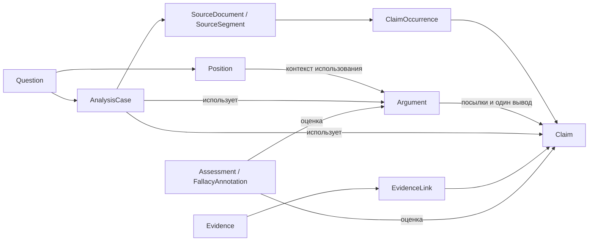
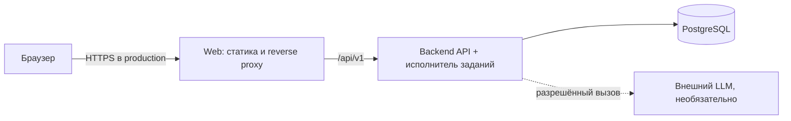

# Архитектура и инфраструктура teza

[Спецификация](SPECIFICATION.md) описывает поведение продукта,
[исследовательские данные](RESEARCH-DATA.md) — обработку текстов и статистику.

## 1. Основное решение

Для MVP достаточно двух прикладных репозиториев: `teza-backend` и `teza-web`.
Backend — модульный монолит на Java, frontend — отдельное React-приложение.
Хранилище — один PostgreSQL. AI — внутренний модуль backend с заменяемыми
адаптерами и долговечными фоновыми заданиями.

### Java или Kotlin

Остаётся Java 21. Kotlin даёт не только краткий синтаксис: у него есть
контроль null на уровне типов, удобные data/sealed-типы и корутины.
Но эти преимущества не решают отдельной обязательной задачи teza:
Java 21, records, sealed-типы и средства Spring достаточны для текущей модели.
При JPA Kotlin также требует учитывать плагины, открытость классов и прокси.
Второй JVM-язык и перенос проекта не нужны без конкретной причины.

### Достаточный объём кода

- **KISS — сохранять простоту:** один backend и одна БД, обычные транзакции
  и понятные прикладные операции. Простое решение должно выполнять требования,
  включая сохранность заданий и проверку доступа.
- **DRY — не дублировать знания:** правила доступа, отношения графа и контракты
  имеют одно место определения. Похожие строки кода не требуют общей
  абстракции, если за ними стоят разные правила.
- **SOLID — ясные обязанности и заменяемые зависимости:** отделить доменные
  правила от HTTP, хранения и AI. Интерфейсы нужны на реальных границах;
  не создавать интерфейс и иерархию для каждого класса.
- **YAGNI — не писать заранее ненужное:** никаких пустых сервисов, адаптеров,
  универсального движка плагинов, схем платежей или исследовательских таблиц
  до появления реализуемого сценария.

Модульные границы ниже — организация кода по ответственности. Они не обязывают
сразу создавать отдельные Maven-модули, слои с пустыми делегатами или framework.

Модуль кода, Git-репозиторий и работающий процесс — разные границы. Разделение
backend и web упрощает владение сборками и зависимостями Java/TypeScript;
для доменных модулей внутри backend независимые репозитории пока создадут
больше затрат на версии, транзакции и интеграцию, чем пользы.

### Распределение по репозиториям

| Репозиторий | Что ему принадлежит | Что ему не принадлежит |
| --- | --- | --- |
| `teza` | Обложка, спецификация, архитектурные решения, карта компонентов; позже инструкция и Compose совместного запуска, совместимые версии образов | Прикладной код и его зависимости; реализация API и миграций |
| `teza-backend` | API `/api/v1`, доменная логика, доступ, PostgreSQL/Flyway, задания, AI-адаптеры, промпты/схемы, seed и backend/AI-тесты, OpenAPI, Dockerfile | React-клиент, отдельная копия инфраструктуры всей системы |
| `teza-web` | UI и редакторы, визуализация графа, локализация, клиент API, frontend-тесты, сборка статики и Dockerfile | Прямой доступ к БД, LLM-ключи, авторитетные доменные правила |

В `teza` достаточно хранить ссылки и совместимые версии компонентов.
Отдельные `teza-ai`, `teza-auth`, `teza-graph`, `teza-contracts` и `teza-infra`
для первого релиза не нужны.

## 2. Модули backend

Предлагается один Maven-проект с wrapper и пакетами по функциональным областям.
Каждый модуль закрывает свои persistence-детали и предоставляет прикладной
интерфейс — например, обычный сервис с понятными методами. Отдельный Java
`interface` нужен только там, где оправдана замена реализации.
Это не набор Spring Boot-сервисов и не отдельные Java-репозитории.
Архитектурные тесты впоследствии проверят отсутствие циклических зависимостей.

| Модуль | Ответственность и основные данные |
| --- | --- |
| `identity` | Вход редактора, сессии и права; посетитель читает опубликованное. На первом запуске достаточно одной редакторской/административной записи. |
| `cases` | Вопросы, темы, позиции, разборы; владение и контекст доступа. |
| `sources` | Подготовленные обезличенные тексты, версии и сегменты, правила использования и сроки хранения; закрытый доступ к рабочим фрагментам. |
| `knowledge` | Claim, ClaimOccurrence, Argument, ArgumentPremise, Relation; области повторного использования, связи графа с вопросами/разборами и правила нормализации/эквивалентности. |
| `review` | Evidence, EvidenceLink, Assessment, FallacyAnnotation, DiscourseMarker; подтверждение, отклонение и история проверок. |
| `analysis` | AnalysisJob, очередь и исполнение, версии движка/промптов/схем, AI-предложения, бюджеты, контракт `AnalysisEngine`, mock и реальные адаптеры. |
| `publishing` | Подготовка и проверка публикации, разрешённая публичная проекция, журнал; JSON/Markdown-экспорт видимого пользователю графа. |

### Направление зависимостей

- `identity` предоставляет контекст пользователя; он не зависит от доменов анализа.
- `cases` предоставляет идентификаторы, разрешённые метаданные и права
  на разбор. `sources` использует этот интерфейс для доступа к исходникам;
  `cases` не зависит от `sources` или графа.
- `knowledge` использует интерфейсы `cases`, `sources` и `identity`;
  `review` — также интерфейсы `knowledge`. Они не зависят от AI-провайдера.
- `analysis` читает разрешённые данные `cases`/`sources`/`knowledge`/`review` и формирует
  предложения. Применение предложений вызывает обычные валидируемые команды
  владельцев данных, а не прямые записи в их таблицы.
- `publishing` собирает разрешённые данные через интерфейсы предыдущих модулей;
  доменные модули не зависят от публикации или формата экспорта.
- REST-контроллеры вызывают прикладные операции; HTTP DTO, AI DTO
  и persistence-сущности не становятся одной общей моделью.

`ClaimOccurrence` связывает Claim с версией подготовленного SourceSegment.
Эта ассоциация управляется модулем `knowledge`, но доступ к рабочему фрагменту
проверяется по разбору, а не только по видимости Claim. Публичный тезис
не раскрывает закрытый текст. `sources` не зависит от `knowledge`, поэтому
обратного цикла между исходниками и графом нет.

### Связь с DDD

Это прагматичный Domain-Driven Design — проектирование вокруг предметной
области: единый словарь Claim/Argument/Evidence, явные правила и логические
границы ответственности. Пакет сам по себе ещё не является bounded context
(ограниченным контекстом), а отдельная сущность не обязана становиться сервисом.

Агрегат — граница согласованных изменений: например, Argument вместе с порядком
его посылок; AnalysisJob вместе с переходами состояния и попытками исполнения.
Claim остаётся отдельно переиспользуемым объектом, а не вложенной копией
каждого Argument. Весь граф не становится одним огромным агрегатом.
Точные транзакционные границы определяются сценариями изменения данных.

Event sourcing, отдельные модели CQRS и шины доменных событий для MVP
не требуются. Доменное правило можно выразить простым методом и транзакцией;
технические паттерны добавляются при решении конкретной проблемы.

## 3. Модель графа: решения до первой миграции

Ниже концептуальные связи; это не окончательная ERD и не схема БД.

Детали, которых недостаточно в исходном перечне полей и которые нужно
явно учесть в схеме:

1. **Границы графа.** Добавить явные связи вопроса/разбора с используемыми
   Claim, Argument и Relation. Принадлежность только через SourceDocument
   не покрывает созданные вручную узлы и переиспользованные аргументы.
2. **Аргумент и происхождение.** Хранить ссылки на исходные фрагменты для
   аргумента и отношения, а также авторство ручной реконструкции. Warrant,
   условия и исключения не растворять в тексте Claim.
3. **Типизированные цели.** Зафиксировать матрицу допустимых source/target
   для каждого Relation и целей Assessment/FallacyAnnotation. Одних
   универсальных `source_node_id`/`target_node_id` без ссылочной целостности
   недостаточно. Вариант таблиц/ключей выбирается на этапе модели.
4. **Специальные отношения.** Посылки и вывод представлены явно через Argument
   и ArgumentPremise, связь источника с тезисом — через EvidenceLink.
   Не создавать конкурирующие независимые записи той же связи в Relation.
   Backend формирует их единое представление для графа.
5. **Позиция и контекст.** Принадлежность аргумента позиции, его pro/contra
   и связь с вопросом задаются контекстными связями. Свойство Claim не меняется
   от того, по какую сторону нового вопроса его используют.
6. **Версии текста.** Обезличивание выполняется до сохранения и сегментации.
   После сегментации сохранять неизменяемую версию подготовленного текста;
   правка создаёт новую версию. Для браузерного клиента предлагаются
   смещения `[start, end)` в UTF-16 по точному сохранённому тексту, без скрытой
   нормализации переносов после сегментации. Экспорт указывает эту систему
   координат; тесты покрывают кириллицу, emoji и переносы.
7. **История и конкурирующие правки.** Изменяемые сущности получают ревизии
   и optimistic locking. Объединение/разделение сохраняет происхождение;
   изменение переиспользуемого Claim не должно незаметно менять чужие разборы.
   Существенное изменение смысла требует нового Claim/версии и явного
   обновления ссылок, а не глобальной перезаписи канонического текста.

### Проверка отношений

Минимальные смысловые правила: `undercuts` указывает на рассуждение/переход,
`attacks_premise` идентифицирует оспариваемую посылку конкретного аргумента,
`rebuts` — оспариваемый вывод. `equivalent_to` не заменяет ручную проверку
эквивалентности. Граф допускает циклы, поэтому экспорт, обход и сворачивание
ветвей не должны предполагать дерево или DAG.

## 4. Публичная база и рабочие материалы

Опубликованный граф — продукт teza. Оригинальные комментарии и профили
участников не являются его содержимым. Рабочие материалы и публичные версии
разделяются логически в одной БД; отдельные хранилища и многотенантность
для первого запуска не нужны.

- В рабочий слой принимается подготовленный текст без идентифицирующих
  сведений об участниках. На MVP — синтетические примеры или заранее
  проверенный разрешённый корпус; произвольный сбор реальных комментариев
  не заменяется предположением, что AI затем всё обезличит.
- AI выделяет содержательную часть, предлагает каноническую формулировку
  и отдельно аннотации ошибок/маркеры обсуждения. Ненужные фрагменты
  не сохраняются как публичные цитаты. Нет аргумента — нет искусственного Claim.
- Редактор проверяет сохранность смысла, обезличенность и разрешённость
  использования. Публикация фиксирует проверенную версию графа и аннотаций.
- Публичная выдача имеет отдельные DTO с разрешёнными полями; в неё не попадают
  исходные фрагменты, идентифицирующие URL, локальные ключи исходников
  или закрытые метаданные. Это относится также к поиску, графу и экспорту.
- Повторное использование Claim/Argument не раскрывает рабочие материалы.
  Исправление черновика не меняет незаметно ранее опубликованный разбор.
- Служебные связи с принятой обезличенной версией позволяют проверить результат,
  удалить зависимые материалы и пересчитать статистику. Идентифицирующая
  таблица соответствия «исходный автор → внутренний ID» не создаётся.

Публичность и анонимность — разные свойства. Даже закрытое хранение личного
текста остаётся обработкой данных; даже перефразированный публичный тезис
может быть узнаваем по редкому событию. Ограничения и правовые ориентиры
описаны в [исследовательских данных](RESEARCH-DATA.md).

Платный доступ к отдельным разборам — возможное развитие. Право просмотра
такого разбора относится к политике доступа, а не к истинности Claim,
идентичности аргумента или AI-модели. Платежи, подписки и инфраструктура
монетизации до отдельной задачи не реализуются; обезличенность обязательна
и для бесплатного, и для платного материала.

## 5. AI и фоновые задания

### Смена провайдера, модели или AI-агента

Домен зависит от одного прикладного контракта `AnalysisEngine`, а не от SDK
конкретного поставщика. Контракт принимает разрешённый версионированный текст
и возвращает типизированные предложения: тезисы, аргументы, отношения,
аннотации ошибок и маркеры. За ним может работать прямой LLM-вызов,
агентная реализация или mock. Отдельная иерархия «провайдер → агент → плагин»
до появления необходимости не создаётся.

Каждый результат хранит идентификатор и версию движка/агента, провайдера/модели,
промпта, схемы и входа. Выбор реализации задаётся конфигурацией; секреты
и AI-инструменты остаются на серверной стороне. Инструменты внешнего агента,
если понадобятся, доступны только через явно разрешённые операции backend.
Ни одна реализация не получает прямую запись в БД или свободное выполнение кода.

Смена реализации проходит общий набор контрактных и смысловых примеров:
совместимость DTO не доказывает качество разметки. Если новый поставщик
не поддерживает нужную операцию, возвращается явная ошибка возможности,
а не выдуманный результат. Совместимый адаптер достаточен; новый сервис
и новый репозиторий для смены модели не нужны.

Подтверждённый граф и ручные правки сохраняются. Смена движка сама по себе
не перезапускает анализ и не списывает деньги; переанализ запускается явно
и создаёт отдельный набор предложений. Старые задачи привязаны к своей
конфигурации попытки, а не незаметно переключаются на другую модель.

### Почему не отдельный AI-сервис

ТЗ не требует Python, GPU, собственной модели или независимого масштабирования
инференса. Внешний LLM вызывается из Java-адаптера. Отдельный сервис добавил бы
сетевой протокол, отдельное развёртывание, секреты, retries и согласование версий
без необходимой для MVP пользы. Версионированные схемы и адаптеры оставляют
возможность выделения позже.

### Предлагаемый поток

1. API проверяет права, лимиты и допустимость передачи подготовленного текста провайдеру;
   сохраняет `AnalysisJob` и ссылки на версии входных данных в PostgreSQL.
   Долгий вызов модели не удерживает HTTP-запрос.
2. Исполнитель забирает задание с блокировкой, lease/heartbeat и идентификатором
   попытки. На MVP это ограниченный пул внутри backend; PostgreSQL — долговечная
   очередь. Один `@Async` без сохранённого состояния не обеспечивает восстановление.
3. Адаптер возвращает структурированные предложения. Backend проверяет схему,
   типы, существование фрагментов, смещения и допустимость отношений.
   Смысловая правильность остаётся предметом проверки человеком и AI-evaluation.
4. Предложения сохраняются отдельно от подтверждённого графа, с версиями
   движка/агента, провайдера, модели, промпта, схемы и входа. Для незавершённых результатов
   пользователь видит ошибку или частичный результат с явным статусом.
5. Пользователь подтверждает, отклоняет или изменяет предложения. Их применение
   проходит доменные правила, проверку доступа и ревизии. Mock-результат всегда
   отмечен как демонстрационный и не выдаётся за реальный вызов модели.

Повторный запуск создаёт новую попытку/набор предложений, а не очищает граф.
Если вход или граф изменился во время задачи, результат помечается устаревшим
и не применяется автоматически. Идемпотентный ключ защищает от повторной
постановки одного запроса. Lease и attempt-id предотвращают применение
запоздалого результата прежнего исполнителя после retry или отмены.

Нужны timeout, ограниченные retries с задержкой и учётом лимитов, восстановление
после падения процесса и отсутствие повторного применения результата.
Не обещать exactly-once вызов платного внешнего API: если провайдер не поддерживает
идемпотентность, сбой после отправки может означать повторный расход.
Резервирование бюджета и ограничения числа попыток учитывают этот случай.

Результаты переиспользуются только при совпадении версий входа, схемы,
промпта, движка/агента, модели и области доступа; общий кэш не раскрывает рабочие материалы.
Операции с доказательствами анализируют только реально предоставленные
или разрешённо полученные данные. Поиск по одному DOI/URL и извлечение полного
текста не появляются неявно вместе с подключением LLM.

## 6. Минимальная инфраструктура

| Компонент | Решение для MVP |
| --- | --- |
| Backend | Java 21, Spring Boot 3.x, Web, Data JPA, Security, Bean Validation, Flyway; Maven wrapper. Точные поддерживаемые patch-версии закрепить до разработки. |
| Frontend | React, TypeScript, Vite, React Router, TanStack Query, React Flow; UI-библиотеку и совместимые версии Node LTS/пакетов выбрать и закрепить lockfile в `teza-web`. |
| Хранение | Один PostgreSQL с постоянным volume; подготовленные тексты в закрытых таблицах, опубликованный граф в реляционных связях. Полнотекстовый поиск без embeddings. |
| Локальный полный запуск | Docker Compose: `web`, `backend`, `postgres`. Без ключа LLM — ручная работа и mock. Исходники модулей в соседних checkout, без обязательных submodules. |
| Разработка | PostgreSQL в контейнере; backend через Maven wrapper, web через Vite с proxy `/api`. Полный Compose — также проверка сборки образов. |
| Production MVP | Те же компоненты на одном подходящем хосте, HTTPS/reverse proxy, закрытая БД, резервные копии вне хоста. Это начальная схема без высокой доступности. |
| Секреты | Настройки через окружение; `.env.example` содержит имена и безопасные примеры. Пароли БД/ключи LLM не хранятся в Git, web-сборке или логах. Production использует защищённое хранилище секретов выбранного хостинга. |
| Наблюдаемость | Health/readiness, correlation/job-id, длительность и ошибки задач, токены/затраты, состояние миграций и резервных копий; без записи приватных текстов. |

Для веб-приложения предлагается один origin и серверные сессии Spring Security:
HttpOnly cookie, Secure в production, подходящий SameSite, CSRF-защита
для изменяющих операций. В dev Vite proxy сохраняет схему одного origin.
Отдельный auth-сервис и хранение токенов в localStorage для этого не нужны.

Готовность backend означает успешные миграции и доступность БД. Недоступность
внешнего LLM не должна выключать ручной режим и mock. Readiness не заменяет
функциональный smoke-сценарий: создать вопрос/анализ, сохранить граф, открыть
его повторно и экспортировать под нужным пользователем.

Flyway запускается одним ответственным процессом перед готовностью API;
отдельный worker впоследствии не конкурирует с ним за миграции. Нужны процедуры
backup/restore PostgreSQL с проверкой восстановления. Откат образа не гарантирует
совместимость с уже выполненными миграциями; изменения БД планируются с учётом
совместимости, а не через разрушительный откат данных.

Не нужны на старте: Redis/RabbitMQ/Kafka, Kubernetes, Neo4j, Elasticsearch,
обязательное объектное хранилище, векторная БД или GPU.
pgvector можно добавить при подтверждённой пользе семантического поиска;
файловое/объектное хранилище — при появлении загрузки документов.

## 7. Контракты и совместный запуск

- **OpenAPI:** канонический контракт принадлежит `teza-backend`, рядом
  с реализацией и его проверками. `teza-web` получает типы/клиент из фиксированной
  версии контракта; вручную поддерживаемой второй схемы не создаётся.
- **AI-схемы и промпты:** внутри `teza-backend`, с версиями и evaluation fixtures;
  будущий удалённый AI-сервис сможет принять тот же контракт.
- **Экспорт:** версионированная JSON-схема backend с устойчивыми ID и системой
  координат исходных фрагментов; экспорт соблюдает права и не раскрывает
  закрытые тексты через публичный граф. Редакторский экспорт может содержать
  разрешённые рабочие связи; публичный содержит только опубликованные поля
  и публичные ID, без идентификаторов и ссылок закрытого Source Layer.
  Markdown — отдельное представление.
- **Обложка:** `teza` хранит обзор и совместимые версии образов/контрактов.
  Позже здесь размещается общий Compose, а Dockerfile каждого приложения —
  в его собственном репозитории. Не использовать плавающий `latest` как
  единственный способ связать релизы.
- **Локальная разработка:** достаточно соседних папок
  `teza`, `teza-backend`, `teza-web`; пути совместного запуска задаются явно.

План CI: backend — сборка, unit/integration с настоящим PostgreSQL, миграции,
контракт и AI fixtures; web — типы, тесты, production build;
совместный релиз — сквозной smoke по фиксированным версиям. Все обязательные
проверки работают без платного API, используя детерминированный mock.
Проверка реального провайдера проводится отдельно при наличии ключа и бюджета;
mock не доказывает качество реальной AI-разметки.

## 8. Когда выделять дополнительные компоненты

| Наблюдаемая потребность | Следующее изменение |
| --- | --- |
| Долгие задачи мешают API либо нужен отдельный жизненный цикл исполнителей | Отдельный worker-процесс из того же backend-артефакта и репозитория. Сохранить долговечную очередь и контроль попыток. |
| Нужен Python/GPU, независимая команда/релизы AI или доказана отдельная нагрузка | Выделить AI-сервис и, при необходимости, репозиторий; версионировать протокол предложений. Он не владеет основным графом. |
| Лимиты PostgreSQL-очереди подтверждены измерениями | Добавить брокер с outbox/идемпотентностью. Наличие фоновых задач само по себе брокера не требует. |
| Разрешены новые платформенные источники | Добавлять Platform Adapter; сначала внутренние адаптеры, отдельный сервис только при иной модели доверия/нагрузки. |
| Нужен более качественный поиск совпадений | Оценить pgvector на размеченных примерах; не вводить автоматическое объединение. |
| Несколько окружений/продуктов и независимый цикл эксплуатации | Рассмотреть отдельный инфраструктурный репозиторий; для одного MVP обложки достаточно. |

## 9. Порядок дальнейшей работы

1. **Модель.** ERD, контекстные связи, типы узлов/отношений, обезличенная версия
   текста, review и публикация. Проверить AC-05, повторное использование Claim
   и отсутствие закрытых фрагментов в публичном графе/экспорте.
2. **Foundation.** Зафиксировать точные версии инструментов; создать приложения,
   миграции, авторизацию и минимальный Compose/конфигурацию совместного запуска.
3. **Knowledge Model.** Домены и CRUD, доступ, валидация графа, происхождение,
   учебные данные и интеграционные тесты.
4. **Web Interface.** Каталог, редакторы, граф, источники и ручная проверка.
5. **AI Integration.** Долговечные задания, mock, заменяемый движок,
   переформулирование, маркеры, версии предложений, лимиты и безопасное применение.
6. **Quality and Release.** Публикация, экспорт, проверки обезличивания и отказов,
   backup/restore, production-like запуск, документация и все AC-01…AC-16.

Статистика и сравнение реакций по контексту следуют после базового сценария.
На старте достаточно PostgreSQL-запросов/представлений над проверенными данными;
отдельный сервис, хранилище аналитики и пустой модуль `research` заранее не нужны.

## 10. Что ещё нужно определить

Это вопросы перед соответствующим этапом реализации, а не причины создавать
дополнительные сервисы прямо сейчас:

- **Перед схемой и API:** окончательная матрица отношений, версия/идентичность
  переиспользуемых объектов, формат публичной проекции и точная политика модерации.
- **Перед Foundation:** точные версии Spring Boot/PostgreSQL/Node, UI-библиотека
  и схема выпуска контрактов. Java 21 и предложенный стек сохраняются.
- **Перед реальной AI-интеграцией:** провайдер/модель, доступные данные,
  разрешение на передачу, лимиты и бюджет. До этого используется mock.
- **Перед production:** хостинг и домен, ожидаемая нагрузка, сроки хранения,
  правила удаления и отзыва публикаций, целевые RPO/RTO резервного копирования.
- **Перед статистикой:** единицы подсчёта, состав корпуса, правила привязки ответа
  к аргументу, версии текстовых признаков, пороги малых групп и ограничения
  интерпретации. Подробности — в документе об исследовательских данных.
- **Перед соцсетями или внешним поиском:** конкретные лицензии, API,
  разрешённые адреса и ограничения получения/использования материалов.
